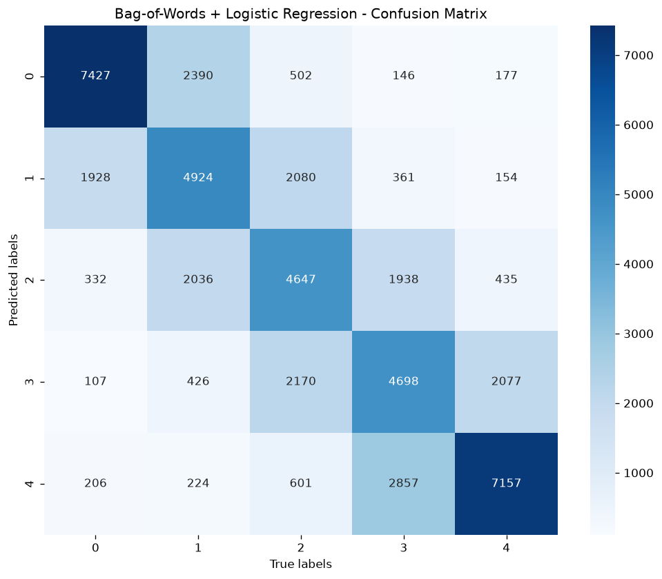
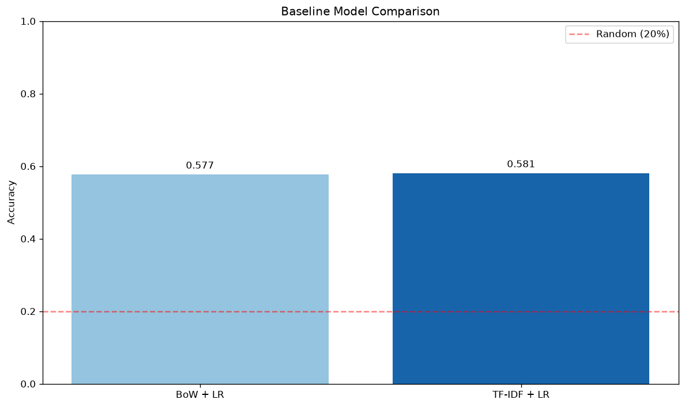

# Research report: Yelp 5-class review classification, BoW vs TF-IDF + Logistic Regression

All numbers come from logged runs made on 2026-10-31 at commit `ff66b582532d66a4a6dee29d32b32725573e56f6`. Differences between two logged values are shown as derivations. No external benchmark figures are used. Measurement logs were kept outside the repository (run artifacts, not committed).

## Summary

- Task: classify Yelp reviews into 5 star classes (labels 0-4) from `Yelp/yelp_review_full`, using a vectorizer plus Logistic Regression.
- On the full data (650000 train / 50000 test), TF-IDF reached accuracy 0.5830 and BoW 0.5681 (difference 0.5830 - 0.5681 = 0.0149).
- Both models place 0.9238 (BoW) and 0.9321 (TF-IDF) of the test reviews within one star of the true label; the errors are mostly between adjacent classes.
- Accuracy grows with training size for both models (1k to full, see sweep table); TF-IDF was ahead at every size measured.
- The pipeline does not use `TextPreprocessor`; the actual text handling is done by the sklearn vectorizer (see Setup). Several documentation/configuration mismatches found are listed in [known-issues.md](known-issues.md).

## Setup

**Dataset.** `Yelp/yelp_review_full`, train split 650000 rows, test split 50000 rows. Both splits are balanced: 130000 per class in train, 10000 per class in test. Review length in words (whitespace split): train mean 134.1, median 99, p95 370, max 1052; test mean 134.3, median 99, p95 368, max 1009. No separate validation split: the test split is the only held-out data, and no tuning was done on it.

**Actual preprocessing path.** `TextPreprocessor` is not used by the pipeline. Text goes raw into the sklearn vectorizer, which does:

- lowercase (default sklearn tokenization, default token pattern) and unigrams only;
- sklearn built-in English `stop_words` (not the NLTK list);
- `min_df=50`; BoW does not receive `max_df` (sklearn default 1.0, i.e. no upper cut-off); TF-IDF uses `max_df=0.5`.

`expand_contractions` and any punctuation handling in `TextPreprocessor` have no effect on these runs. Vocabulary size is 22027 for both models.

**Classifier.** `LogisticRegression` with lbfgs (sklearn default solver), default `C=1.0`, `max_iter=1000`, `random_state=42`. No hyperparameter tuning was performed.

**Environment.** Python 3.12.15, scikit-learn 1.9.1, numpy 2.5.4, scipy 1.18.1, datasets 5.1.0, nltk 3.10.4, contractions 0.1.73. CPU Intel Core Ultra 7 258V, 8 cores, 15 GB RAM (WSL2).

**Measurement method.**

- Full-data numbers come from an external harness (not committed) that calls `src.main.run_single_model` for `bow` and `tfidf` with `sample_size=None`. It only adds printing of the confusion matrix, label counts, word lengths, top features, within-one-star rate and MAE, and saves the project's own plots (figures below). Metrics themselves come from the project's code. Run once: `/usr/bin/time` total 11:17.33 wall, max RSS 2247724 kB.
- Sweep numbers (1k, 10k, 100k) come from the CLI: `uv run python -m src.main baseline N`. Those runs print accuracy only.
- The custom workflow comes from `uv run python -m src.main custom`.
- A first full CLI `baseline` run was aborted after about 5 minutes (terminated, exit 143); it produced no result and is not reported.

## Results

### Full data (650000 train / 50000 test), single run

| Metric | BoW + LR | TF-IDF + LR | TF-IDF - BoW |
|---|---|---|---|
| Accuracy | 0.5681 | 0.5830 | 0.0149 |
| Macro precision | 0.5625 | 0.5792 | 0.0167 |
| Macro recall | 0.5681 | 0.5830 | 0.0149 |
| Macro F1 | 0.5646 | 0.5808 | 0.0162 |
| Within one star | 0.9238 | 0.9321 | 0.0083 |
| Off by two or more | 0.0762 | 0.0679 | -0.0083 |
| MAE (stars) | 0.5358 | 0.5108 | -0.0250 |
| Vocabulary size | 22027 | 22027 | 0 |
| Wall time (train + predict, s) | 468.0 | 201.5 | -266.5 |

Per-class F1 (BoW / TF-IDF): class 0 0.71 / 0.73, class 1 0.49 / 0.51, class 2 0.47 / 0.49, class 3 0.48 / 0.50, class 4 0.67 / 0.68. Per-class recall: class 0 0.74 / 0.75, class 1 0.47 / 0.50, class 2 0.46 / 0.48, class 3 0.47 / 0.49, class 4 0.71 / 0.69.

### Confusion matrices (rows = true class 0-4, columns = predicted class 0-4)

BoW:

| true \ pred | 0 | 1 | 2 | 3 | 4 |
|---|---|---|---|---|---|
| 0 | 7362 | 1938 | 372 | 132 | 196 |
| 1 | 2487 | 4726 | 2111 | 449 | 227 |
| 2 | 521 | 2072 | 4601 | 2181 | 625 |
| 3 | 146 | 372 | 1915 | 4650 | 2917 |
| 4 | 171 | 146 | 451 | 2166 | 7066 |

TF-IDF:

| true \ pred | 0 | 1 | 2 | 3 | 4 |
|---|---|---|---|---|---|
| 0 | 7512 | 1941 | 286 | 100 | 161 |
| 1 | 2356 | 5040 | 2029 | 381 | 194 |
| 2 | 485 | 2121 | 4753 | 2134 | 507 |
| 3 | 163 | 354 | 1982 | 4926 | 2575 |
| 4 | 183 | 150 | 431 | 2318 | 6918 |




The project's plots are the transpose of the tables above (y axis = predicted, x axis = true), so the first plot row is the first table column.



### Sample-size sweep (CLI `baseline N`, first N rows of train and of test)

| Sample size | BoW accuracy | TF-IDF accuracy | TF-IDF - BoW | CLI wall time (both models) |
|---|---|---|---|---|
| 1000 | 0.3300 | 0.3600 | 0.0300 | 0:09.37 |
| 10000 | 0.4725 | 0.5050 | 0.0325 | 0:10.01 |
| 100000 | 0.5286 | 0.5557 | 0.0271 | 3:36.35 |
| full (650000 / 50000, harness) | 0.5681 | 0.5830 | 0.0149 | 11:17.33 total for both models plus plots |

Gain from 100000 to full: BoW 0.5681 - 0.5286 = 0.0395; TF-IDF 0.5830 - 0.5557 = 0.0273.

### Custom workflow (`custom`)

BoW, first 5000 train and 5000 test rows, vocabulary size 1000 (a hand-composed workflow with its own settings): accuracy 0.4404, macro precision 0.4357, macro recall 0.4389, macro F1 0.4361; wall time 0:07.90. Top 5 features: class 0 worst, terrible, awful, horrible, rude; class 4 perfect, favorite, fantastic, amazing, takes. This is not comparable to the baseline rows (different size and vocabulary cap).

### Top features (full data, top 10 per class)

- TF-IDF class 0: worst, horrible, zero, awful, terrible, waste, poisoning, bland, disgusting, rude. Class 4: amazing, delicious, best, awesome, great, excellent, perfect, fantastic, love, incredible.
- BoW class 0: poisoning, crooks, disgrace, worst, nworst, riddance, portray, deplorable, methinks, crook. Class 4: yummiest, mazing, surpassed, nhighly, exceeded, rejoice, elated, nfive, awsome, gratuitous.
- Tokens such as `nworst`, `nmeh`, `nfive`, `nhighly` appear in the lists (see Limitations).

## Analysis

- TF-IDF beat BoW on every full-data metric except class-4 recall (0.69 vs 0.71) and was faster in this run (201.5 s vs 468.0 s). The accuracy gap is 0.0149 on a single split; no variance estimate exists, so the size of the gap is not established beyond this run.
- TF-IDF led at every sample size in the sweep (gaps 0.0300, 0.0325, 0.0271, 0.0149 from 1k to full), and the gap was smaller at full data than at 1k-100k.
- Accuracy still rose from 100000 to full data (BoW +0.0395, TF-IDF +0.0273), so no plateau is shown at the sizes tried.
- The extreme classes are easier: F1 for classes 0 and 4 (0.71, 0.67 BoW; 0.73, 0.68 TF-IDF) exceeds the middle classes 1-3 (0.47-0.49 BoW; 0.49-0.51 TF-IDF).
- Errors are mostly adjacent. For BoW, 0.9238 of reviews are within one star; the largest off-diagonal cells are neighbours (true 3 predicted 4: 2917; true 1 predicted 0: 2487; true 2 predicted 3: 2181). TF-IDF shows the same pattern (true 3 predicted 4: 2575; true 1 predicted 0: 2356).
- BoW and TF-IDF have the same vocabulary size (22027) although only TF-IDF applies `max_df=0.5`; the logs do not show which terms each filter removed.
- TF-IDF top features are sentiment words, whereas BoW's top features include rare tokens (`crooks`, `riddance`, `nworst`); with unscaled counts the largest coefficients attach to rare terms. This is an observation from the feature lists, not a tested cause.

## Limitations

- One seed (42), one split, no confidence intervals, no repeated runs; the 0.0149 gap is a single measurement.
- No hyperparameter tuning (`C`, `max_iter`, `min_df`, `max_df`, n-grams, solver all at the values above).
- The sweep takes the first N rows of both train and test (`DataLoader` does not shuffle). The first 1000 test rows are not balanced (counts per class 0-4: 189, 204, 245, 215, 147), so the 1k result is on a skewed test subset. Sweep wall times were not measured in isolation (runs overlapped other activity, per the log start/end timestamps, local time: the aborted full CLI run ran 12:55:57-13:01:18; sweeps ended 12:56:32, 12:56:42, 13:00:26; custom 13:00:34), so they are indicative only; full-data wall times come from a separate run.
- `configure_environment` suppresses all Python warnings (`category=Warning`), so lbfgs convergence warnings, if any, were not visible and convergence at `max_iter=1000` is not verified.
- Literal backslash-n sequences occur in the dataset text: 25130 of 50000 test rows contain them. The default tokenizer turns `\nworst` into `nworst`, as shown in the top features; no cleaning is applied.
- The full-data numbers come from an external harness rather than the committed CLI (the CLI `baseline` prints accuracy only and its full run was aborted).
- Metrics are reported on the test split only; BoW max_df is not set, so the BoW/TF-IDF comparison also differs in `max_df` (1.0 vs 0.5) in addition to term weighting.

## Reproduction

```
git checkout ff66b582532d66a4a6dee29d32b32725573e56f6
uv sync
MPLBACKEND=Agg uv run python -m src.main baseline 1000
MPLBACKEND=Agg uv run python -m src.main baseline 10000
MPLBACKEND=Agg uv run python -m src.main baseline 100000
MPLBACKEND=Agg uv run python -m src.main custom
```

The full-data figures need `run_single_model(model_type, sample_size=None)` for `bow` and `tfidf`. Calling it directly (for example from a small script that prints `ctx["metrics"]`) reproduces the table; the harness additionally printed the extra statistics above. The first run downloads the dataset and the NLTK stopwords corpus and needs network access.
